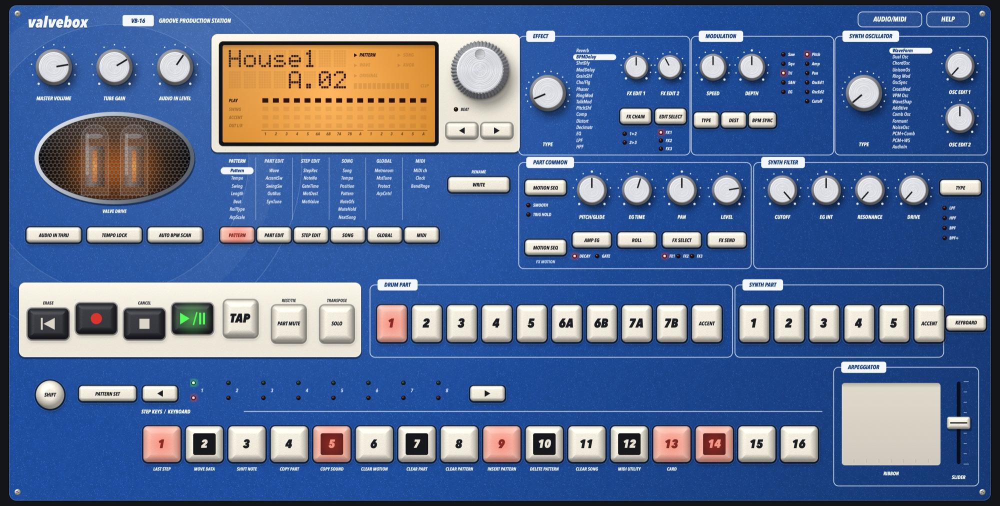

# Valvebox

**VB-16 Groove Production Station.** A desktop groovebox built for research. It reproduces the architecture, controls and behaviour of the classic 2003 valve-equipped groovebox:

- nine drum parts and five monophonic synth parts, plus two accent parts;
- 16 oscillator models;
- three effects with 16 types each;
- a 128-step sequencer with motion sequences, 256 patterns and 64 songs;
- a ribbon arpeggiator;
- a twin-triode valve stage on the main outputs.

Valvebox uses an original name and panel design. It doesn't use any manufacturer's names, logos, artwork, samples or firmware.

C++20 / JUCE 8, macOS (Apple Silicon tested). The engine and panel logic are platform-neutral and unit-tested.



The research behind it, with page references to the original owner's manual and other sources, is in [docs/research.md](docs/research.md).

## Build & run

### Requirements (macOS)

- **Xcode Command Line Tools** (compiler and git): `xcode-select --install`
- **CMake 3.22+ and Ninja**, e.g. with [Homebrew](https://brew.sh): `brew install cmake ninja`

### Build

From the project folder, run these one at a time:

```sh
bash scripts/bootstrap.sh
cmake -S . -B build -G Ninja -DCMAKE_BUILD_TYPE=Release -DVALVEBOX_BUILD_APP=ON
cmake --build build
open build/Valvebox_artefacts/Release/Valvebox.app
```

- `bootstrap.sh` downloads JUCE 8.0.15 into `external/`. It isn't committed to git.
- The first build compiles JUCE too, so it takes a few minutes.
- The first time anything needs the audio input (AUDIO IN THRU, AUTO BPM SCAN or the Audio In oscillator), macOS asks for microphone access.

## Quick start

1. Press **PLAY/PAUSE** (or `Space`). Pattern A.01 plays.
2. Turn the **dial** (or press the `↑` / `↓` arrow keys) to pick another pattern. While playing, the change waits for the end of the current pattern, and the next name blinks until then.
3. Click a **part key** (drum 1–7B or synth 1–5) to select that part. The part's knobs then edit it, and the step keys show and toggle its steps.
4. Turn the knobs. While a knob moves, the LCD shows its value. The **ORIGINAL** indicator lights when the knob is back at the stored value.
5. **WRITE** (`F7`) twice saves the pattern. Memory Protect is on from the factory, like the original. Turn it off under GLOBAL > Protect.

## Playing it

### Computer keyboard

The keyboard works as soon as the window is in front. Keys still held when you switch to another app are released.

| Keys | Panel key |
|---|---|
| `A W S D R F T G H U J I K O L ;` | Step keys 1–16. They play notes when KEYBOARD is on. |
| `1`–`9` | Drum parts 1, 2, 3, 4, 5, 6A, 6B, 7A, 7B |
| `0` | Drum ACCENT |
| `Z X C V B` | Synth parts 1–5 |
| `N` | Synth ACCENT |
| `Shift` | SHIFT |
| `Q` (hold) | PART MUTE / REST·TIE |
| `E` (hold) | SOLO / TRANSPOSE |
| `P` (hold) | PATTERN SET |
| `Y` | TAP |
| `Space` | PLAY/PAUSE |
| `Esc` | STOP/CANCEL |
| `Return` | REC |
| `Backspace` | RESET/ERASE |
| `←` `→` | Cursor < > (moves through the matrix menu) |
| `↑` `↓` | Dial, one click |
| `[` `]` | Select keys < > (bar, octave, pattern-set group) |
| `Tab` | KEYBOARD |
| `F1`–`F6` | PATTERN, PART EDIT, STEP EDIT, SONG, GLOBAL, MIDI |
| `F7` | WRITE |
| `?` | Quick guide |

### With the mouse

- **Knobs:** drag up or down, or scroll.
- **Dial:** drag or scroll. Each detent is one click.
- **Ribbon:** press and drag on it. The **slider** sits beside it.
- **Modifier keys latch with a click:** SHIFT, PART MUTE, SOLO and PATTERN SET. A pointer can't hold two panel keys at once, so clicking one of these keys holds it: it stays pressed in, with an orange ring, until you click it again. SHIFT is one-shot: it lets go after the next key.

### MIDI

- Controllers are picked up when they're plugged in.
- **Audio/MIDI** chooses the output device, the sample rate and buffer, the audio input, and a **MIDI output**.
- **Channels:** the MIDI mode sets a channel for each synth part (defaults 1–5) and one for the drums (default 10). Two synth parts on the same channel both play.
- **Drum notes:** the drums answer the drum note map (defaults C2, D2, E2, F2, G2, F♯2, A♯2, C♯3, D♯3). The map can be changed under MIDI UTILITY.
- **Control changes:** they follow the original's CC numbers, listed in [docs/research.md §6](docs/research.md).
  - A synth part's knobs and keys (FILTER TYPE, AMP EG, MOD TYPE and so on) work on its channel.
  - The effect controls work on the global channel (synth 1's).
  - Moving a knob or pressing a key sends its CC, and incoming CCs move the same controls.
  - The drum parts' knobs aren't on MIDI: the original used NRPN for those.
- **MIDI UTILITY** (MIDI mode, SHIFT + 12):
  - reassigns the knobs' CC numbers;
  - sets the drum note map;
  - sets the P / C / E / N filter, which switches program, control, exclusive and note messages on or off, in and out.
  - The settings are kept when you write the Global data.
- **Program change** selects patterns.
- **MIDI out** sends the sequence's and the keys' notes, the CCs, and clock with start, stop and continue.
  - Each synth part is mono: a new note ends the last one, after it for a tie (legato).
  - STOP and PAUSE end any note still on, so nothing hangs.
- **CLOCK:** Int, Ext or Auto. Ext follows incoming MIDI clock, start, stop and continue.

## The panel

The layout follows the original's sections:

- **Common section:**
  - Knobs: MASTER VOLUME, TUBE GAIN, AUDIO IN LEVEL.
  - The valve window.
  - Keys: AUDIO IN THRU, TEMPO LOCK, AUTO BPM SCAN; RESET/ERASE, REC, STOP/CANCEL, PLAY/PAUSE, TAP, PART MUTE, SOLO; SHIFT, PATTERN SET.
- **LCD:**
  - Parameter and value.
  - PATTERN / SONG / WAVE / KNOB / ORIGINAL / CLIP indicators and the input meter.
  - Four status rows for all 16 parts: PLAY, SWING, ACCENT and OUT L/R.
- **Dial and cursor keys**, the BEAT lamp, **WRITE/RENAME**, and the six **mode keys**. Each mode key has its matrix menu printed below the LCD. The current page is highlighted.
- **EFFECT:**
  - TYPE, a 16-way selector: Reverb, BPM Delay, Shift Delay, Mod Delay, Grain Shifter, Chorus/Flanger, Phaser, Ring Mod, Talk Mod, Pitch Shifter, Compressor, Distortion, Decimator, EQ, LPF, HPF.
  - FX EDIT 1 and 2.
  - FX CHAIN (1→2, 2→3), EDIT SELECT, MOTION SEQ.
- **MODULATION:**
  - SPEED and DEPTH.
  - TYPE: saw, square, triangle, S&H or EG.
  - DEST: pitch, amp, pan, cutoff, OSC EDIT 1 or OSC EDIT 2.
  - BPM SYNC.
- **SYNTH OSCILLATOR:** TYPE is a 16-way selector, with OSC EDIT 1 and 2. The models are: Waveform, Dual Osc, Chord Osc, Unison Osc, Ring Mod, Osc Sync, Cross Mod, VPM Osc, Wave Shaper, Additive, Comb Osc, Noise Osc, Formant, PCM+Comb, PCM+WS and Audio In.
- **PART COMMON:**
  - MOTION SEQ: off / SMOOTH / TRIG HOLD.
  - PITCH/GLIDE, EG TIME, PAN, LEVEL.
  - AMP EG (decay / gate), ROLL, FX SELECT, FX SEND.
- **SYNTH FILTER:** CUTOFF, EG INT, RESONANCE, DRIVE, and TYPE (LPF, HPF, BPF, BPF+).
- **Part keys:**
  - Drum 1–5, 6A, 6B, 7A, 7B and ACCENT; synth 1–5 and ACCENT; KEYBOARD.
  - 6A/6B and 7A/7B are exclusive pairs: if both trigger on one step, B wins. That's the open/closed hi-hat.
- **Select keys and LEDs:**
  - The green row shows the bar playing.
  - The red row shows the bar being edited, the keyboard octave or the pattern-set group.
- **Step keys:** 16 keys laid out like a piano octave.
  - **SHIFT + a step key** runs the function printed under it. 1–8 work in the pattern modes while stopped, 9–11 in SONG mode, 12 in MIDI mode and 13 in GLOBAL mode:
    1. LAST STEP
    2. MOVE DATA
    3. SHIFT NOTE
    4. COPY PART
    5. COPY SOUND
    6. CLEAR MOTION
    7. CLEAR PART
    8. CLEAR PATTERN
    9. INSERT PATTERN
    10. DELETE PATTERN
    11. CLEAR SONG
    12. MIDI UTILITY
    13. CARD
- **ARPEGGIATOR:**
  - The **ribbon** plays the selected part: 16ths on a synth part, with the gate set by where you touch; on a drum part, where you touch sets the rate.
  - The **slider** moves the pitch through the pattern's ARP SCALE (31 scales).

### What the sequencer does

- **Patterns:**
  - Settings: TEMPO 20.0–300.0 (SHIFT + dial for tenths), SWING 50–75 %, LENGTH 1–8 bars, BEAT (16, 32, 8Tri, 16Tri), LAST STEP 1–16, ROLL TYPE 2/3/4, ARP SCALE.
  - Per-part ACCENT, SWING and OUTPUT BUS switches.
  - Swing is ignored on triplet beats, as on the original.
- **Synth steps:**
  - Each step has a note and a gate time.
  - A gate longer than the step ties into the next note. That's legato: no retrigger, and glide applies.
- **Recording:**
  - *Realtime:* REC then PLAY, and play the part keys or the keyboard.
  - *Step recording:* STEP EDIT > Step Rec. REST/TIE (PART MUTE) enters a rest, or a tie with a step key held.
  - *Erase:* SHIFT + hold RESET/ERASE removes the triggers as they pass.
- **Motion sequences:**
  - Up to 24 per pattern.
  - Set the part's MOTION SEQ to SMOOTH or TRIG HOLD (or switch an effect's MOTION SEQ on), press REC and PLAY, and move a knob. It records for one pass, then REC turns itself off.
  - Playback is SMOOTH or TRIG HOLD. Effects always play smooth, and switch-type parameters always play trig-hold.
- **Mute, solo and transpose:**
  - Hold PART MUTE or SOLO and press part keys.
  - Pressing and releasing SOLO alone clears solo and mute.
  - SOLO + dial transposes the synths ±24 semitones.
- **Pattern set:** hold PATTERN SET and press a step key to jump to that key's pattern. There are 8 groups of 16. Holding two step keys sets up chain play.
- **Compare:** SHIFT + PATTERN plays the stored version of an edited pattern.
- **Songs:**
  - Up to 256 positions, each with a pattern and a NOTE OFFSET.
  - MUTE HOLD, NEXT SONG and TEMPO LOCK per song.
  - Event recording of the keys, knobs, mutes and tempo. Each pass replaces only the same kind of event.
  - The select keys rewind and fast-forward.
- **Global:**
  - METRONOME: Off, Rec0, Rec1 (with a one-bar count-in), Rec2, On, On→3/4.
  - MASTER TUNE ±50 cents.
  - PROTECT.
  - ARP CONTROL: Normal or Reverse swaps the ribbon and the slider.
- **AUTO BPM SCAN** listens to the audio input. It's lit while it scans and blinks when it has found a tempo; press it again to apply the tempo.
- **OUTPUT BUS 3/4:** parts on bus 3/4 go to outputs 3 and 4 of the audio device. Choose 4 outputs under Audio/MIDI. As on the original, they skip the effects, the valve stage and MASTER VOLUME. On a stereo-only device they aren't heard.

### Where things are saved

- **Memory:** all 256 patterns, 64 songs, the pattern set and the Global and MIDI settings are kept in `~/Library/Application Support/Valvebox/memory.vbx`. It's saved to disk whenever you WRITE (a pattern, a song, the pattern set, or the Global data) and after Load All. As on the original, anything that isn't written is lost: pattern edits when you change patterns, Global settings when you quit.
- **CARD (SHIFT + 13):** Save All, Load All, Load one pattern, Delete and Format all use files in `~/Music/Valvebox Card`.
- **Between sessions:** the positions of MASTER VOLUME, TUBE GAIN and AUDIO IN LEVEL (physical knobs on the original), the audio device and the MIDI output are remembered.

## How it differs from the original

| Original | Valvebox |
|---|---|
| 207 drum samples and 76 PCM waves in ROM | Synthesized by Valvebox at start-up: modal, noise, metal and plucked-string drum models; additive, FM, plucked-string and formant instrument models. They keep the original's numbering ranges and categories, so "waves 95–120 are hi-hats" still holds, but they're our own sounds with our own names. |
| Two real 12AX7 tubes | A triode model with asymmetric soft clipping, so it adds even harmonics. More TUBE GAIN means more drive and more level, on the main outputs only. |
| SmartMedia card | Files in a folder. MIDI data dumps use the same file format. |
| Hold two panel keys at once | Hold from the computer keyboard, or click to latch the modifier keys. |
| 192 factory patterns | 15 original factory patterns and 2 demo songs. Patterns: Electro1, House1, Techno1, DnB1, HipHop1, Trance1, Acid1, DubTech1, Breaks1, Garage1, Minimal1, IDM1, Ambient1, Funk1, Gabba1. |
| NRPN control (drum parts' knobs) | Not implemented. Control changes, notes, program changes and clock are. |

## Tests

```sh
./build/ValveboxTests_artefacts/Release/ValveboxTests
```

There are **1156 checks**, in three groups:

- **Panel (QC):** drives the headless panel exactly as a player would: keys, knobs, dial, ribbon and slider in; LCD text, LEDs, triggers, MIDI and sound out. It covers:
  - every mode and matrix page, and all the SHIFT functions;
  - swing, roll, BEAT and LENGTH timing, and the 6A/6B and 7A/7B choke pairs;
  - accent levels;
  - write and protect, and compare;
  - mute, solo and transpose;
  - pattern set and chain play;
  - songs and event recording;
  - motion sequences, realtime and step recording, and erase;
  - the arpeggiator and the metronome;
  - MIDI in and out (notes, CCs and their round trip, clock, no hanging notes, CC assignment);
  - the card operations;
  - a check that every key and knob on the panel was tested.
- **Sound (QC):** checks the audio itself:
  - all 207 drum waves are in their categories, and all 76 PCM waves sound;
  - the 16 oscillator models sound and play the note;
  - the filter, the EGs, the drum parts' controls and modulation do what they say;
  - every effect type changes the sound, and FX SEND and the chain route it;
  - the valve stage adds harmonics and level, and the individual outs bypass it;
  - files survive a save and load exactly.
- **Smoke:** builds the factory memory and plays the factory pattern.

### Self-test of the app

This drives the real window: every one of the 68 keys and 19 knobs, the dial, the ribbon and the slider. It then plays a factory pattern and checks that MASTER VOLUME at 0 is silent:

```sh
VALVEBOX_SELFTEST=/tmp/report.txt ./build/Valvebox_artefacts/Release/Valvebox.app/Contents/MacOS/Valvebox
```

Other testing aids:

- `VALVEBOX_MEMORY_DIR=/some/dir` keeps your real memory out of a test session.
- `VALVEBOX_CAPTURE_WAV=/path.wav` records the first 30 s of output.
- `VALVEBOX_WINDOW_SIZE=WxH` forces a window size.
- `VALVEBOX_SNAPSHOT=/path.png` renders the panel at 2× to a PNG and quits (add `VALVEBOX_SNAPSHOT_PLAY=1` to play a pattern first, so the lights and valves are on).

## Source layout

| Folder | What's in it |
|---|---|
| `src/core` | The instrument, with no UI: `Model` (patterns, songs, memory, JSON), `Mapping` (the manual's tables), `Waves`, `Voices`, `Effects` and `Rack` (the sound), `Edit` (pattern operations), and `Machine` / `MachinePlay` (panel logic and sequencer). |
| `src/engine` | Audio and MIDI devices, the memory file, card file jobs. |
| `src/ui` | The panel: widgets, layout on a 1600 × 810 canvas that scales with the window, the rendered materials (aluminium knobs, rubber keys, metallic paint), the LCD's dot-matrix font. |
| `tests` | The unit tests. |
